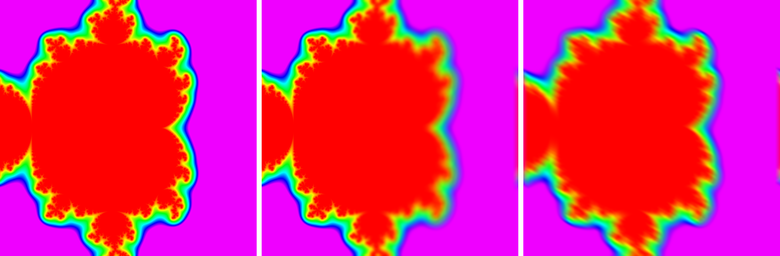

Non-Uniform Blur node
~~~~~~~~~~~~~~~~~~~~~

The **Non-Uniform Blur** node applies a disc blur to its input whose radius is driven,
for each pixel, by a grayscale intensity map. The disc can be squashed into an ellipse
to create anisotropic blurs, made one-sided with the asymmetry, or given a polygonal
shape to imitate the bokeh of a camera aperture.

Unlike the **Blur** node, whose optional amount map scales two separate horizontal
and vertical gaussian passes, this node gathers all samples in a single pass, so the
kernel can take any shape and orientation.

Inputs
++++++

The **Non-Uniform Blur** node accepts an RGBA input to be blurred and an optional
grayscale intensity map. Where the map is white, the blur radius is the *intensity*
parameter; where it is black, the input is not blurred. When the map is not connected,
the whole image is blurred with the maximum radius.

Outputs
+++++++

The **Non-Uniform Blur** node outputs the result of the blur operation.

Parameters
++++++++++

The **Non-Uniform Blur** node has the following parameters:

* The *grid size* defines the resolution at which the input is sampled.

* The *intensity* is the maximum blur radius, in pixels of the grid size.

* The *anisotropy* squashes the blur disc into an ellipse: 0 is a circle and 1 a line.

* The *angle* specifies the orientation of the ellipse when anisotropy is used, and the
  direction of the asymmetry.

* The *asymmetry* fades out the half of the blur that is behind the direction given by
  the angle: 0 blurs in both directions, and 1 in one direction only.

* The number of *samples* taken for each pixel. More samples give a smoother result,
  but are slower.

* The *jitter* rotates the sample pattern by a different angle for each pixel. With
  large radii and few samples, this turns the ring-like artifacts of the fixed pattern
  into fine noise. The angles only depend on the pixel position, so the result is the
  same on every render and still tiles. It is 0 by default, which uses the same pattern
  everywhere: jitter makes large blurs slower (up to about 5 times for large radii),
  since neighbouring pixels no longer read the input at nearby places.

* The number of *blades* of the aperture: 0 gives a round blur, and 3 or more a polygonal
  (bokeh) shape, whose orientation is the *blade rotation*. Note that Substance Designer
  uses the word blades for the number of sampling directions; here the quality only
  depends on the number of samples.

* Whether a *32 Bit* buffer is used to sample the input.
  Reduces banding artifacts but could result in higher video memory usage.

Example images
++++++++++++++

From left to right: the input image, the input blurred with a tilt-shift intensity map
(sharp in a horizontal band, blurred above and below), and bright lights blurred with a
radial intensity map and 6 blades.
