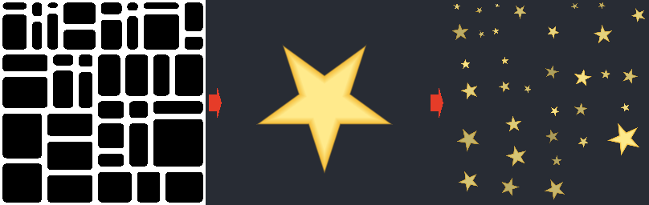

Fill Mapper node
~~~~~~~~~~~~~~~~

The **Fill Mapper** node is a fill companion node that places an instance of a pattern
in each area detected by a **Fill** node, fitted to the area's bounding box, with a random
rotation, size, offset and value per area.

Inputs
++++++

* **Fill**: The input fill data, to be connected to the output of a **Fill** node (or a
  compatible output of another node, such as the *Brick Fill* output of the **Bricks** node)
* **Pattern**: The pattern placed in each area. Its alpha channel is its coverage. When
  this input is not connected, a soft white disc is used

Outputs
+++++++

* **Output**: The patterns placed in the areas, on a transparent background
* **Mask**: The coverage of the patterns (the alpha channel of the output)

Parameters
++++++++++

* **Mode**: How the pattern is fitted to each area:

  * *Stretch*: the pattern is stretched to the area's bounding box
  * *Square*: the pattern is a square that covers the bounding box (like the *Square* mode of
    the **Fill to UV** node)
  * *Fit*: the pattern is the largest square inside the bounding box

* **Scale**: The size of the patterns, relative to their area
* **Scale random**: The random reduction of the size of each pattern
* **Rotation**: The rotation of the patterns, in degrees
* **Rotation random**: The random rotation of each pattern, in degrees
* **Offset random**: The random offset of each pattern, relative to the size of its area
* **Value random**: The random darkening of each pattern
* **Probability**: The probability that an area has a pattern

Notes
+++++

Each pixel only shows the pattern of its own area, so patterns that are larger than their
area (because of the *Square* mode, a scale above 1, a rotation or an offset) are cut at
the area's borders. Outlines (pixels without an area) are transparent, unless the **Fill**
node's *Remove edges* option assigns them to an area.

The random values only depend on the area's bounding box and the node's seed, and come
from an integer hash, so they are the same on every GPU. Areas that wrap around the edges
of the texture get a single instance of the pattern, so the output tiles.

The **Fill to UV** node gives each area a UV map, to be used with custom transforms; the
**Fill Mapper** node does the common case in one node. It is similar to Substance 3D
Designer's *Flood Fill Mapper* node, with a single pattern input.

Example images
++++++++++++++

