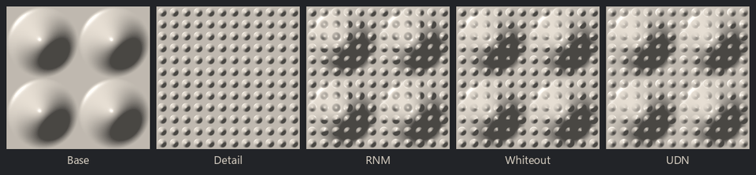

Normal Combine node
~~~~~~~~~~~~~~~~~~~

The **Normal Combine** node applies a detail normal map over a base normal map. It offers three
methods, described in this `article`__:

* *RNM* (Reoriented Normal Mapping) rotates the detail normals so they follow the base, as if the
  details were drawn on the base's surface. It is the most accurate method, and the one used by
  the **Normal Blend** node.
* *Whiteout* and *UDN* are cheaper approximations that add the slopes of both normal maps. They
  flatten the details on the base's slopes, *UDN* more than *Whiteout*, and *UDN* also flattens
  the details where the base is flat.

.. _normalcombinepage: https://blog.selfshadow.com/publications/blending-in-detail/

__ normalcombinepage_

Inputs
++++++

* **Base**: the base normal map
* **Detail**: the detail normal map, applied over the base

An input that is not connected is a flat normal map: with a flat detail, the output is the base,
and with a flat base and the *RNM* or *Whiteout* method, the output is the detail.

Outputs
+++++++

* **Output**: the combined normal map, in the same format as the inputs

Parameters
++++++++++

* **Mode**: the method used to combine the normal maps (*RNM*, *Whiteout* or *UDN*)
* **Strength**: the strength of the detail normal map (0 keeps the base normal map)
* **Format**: the format of both inputs and of the output. *Default* is Material Maker's format,
  generated by the **Normal Map** node and expected by the **Material** node. *OpenGL* and *DirectX*
  are for normal maps in those formats (for example images, or the output of the **Normal Convert**
  node). Both give the same result, since the methods do not depend on the direction of the y axis.

Notes
+++++

The inputs are normalized first. Null vectors are considered flat, and normals that point into the
surface are moved onto it. With the *RNM* method, steep details on steep slopes can point into the
surface; the **Normal Normalize** node moves them back onto it.

Example images
++++++++++++++

A base (large bumps) and a detail (small rivets) normal map, and the 3 methods, lit from the top left:

