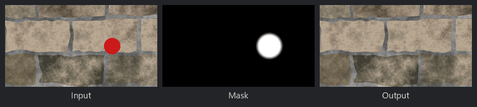

Clone Patch node
~~~~~~~~~~~~~~~~

The **Clone Patch** node copies a circular patch of an image over another area, with soft edges,
to remove blemishes from photos (like the clone stamp tool of image editors). The patch can be
rotated, and it wraps around the edges of the image.

The source and target centers and the radius can be edited in the 2D preview.

Inputs
++++++

* **Input**: the image

Outputs
+++++++

* **Output**: the image with the cloned patch
* **Mask**: the mask of the patch (1 where the image is replaced)

Parameters
++++++++++

* **Source X** and **Source Y**: the center of the copied patch
* **Target X** and **Target Y**: the center of the area that is replaced
* **Radius**: the radius of the patch
* **Softness**: the softness of the patch's edge, relative to its radius
* **Rotation**: the rotation of the copied patch, in degrees

Example images
++++++++++++++

A red blemish on a stone wall, the patch's mask, and the result:

