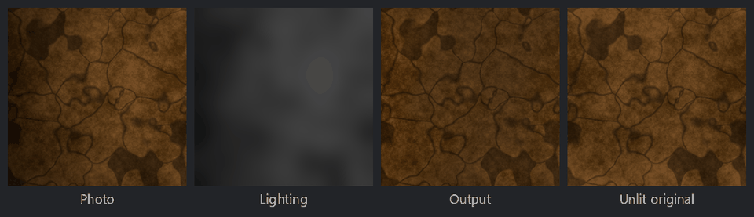

Delight node
~~~~~~~~~~~~

The **Delight** node removes large scale lighting variations (shading, vignetting, light falloff)
from a photo, so it can be used as an albedo map. It divides the photo by its luminance blurred
with a gaussian blur, and multiplies it by the photo's average luminance, so the result keeps the
photo's colors, details and overall brightness.

Only variations larger than the *Radius* are removed: small scale shading (for example ambient
occlusion in the cracks of a surface) is considered part of the texture.

Inputs
++++++

* **Input**: the photo

Outputs
+++++++

* **Output**: the delit photo
* **Lighting**: the estimated lighting (the blurred luminance of the photo)

Parameters
++++++++++

* **Radius**: the size of the lighting variations that are removed, relative to the image size
* **Tileable**: set it for tileable images, so the lighting is estimated across the edges of the
  image. When it is not set, the image is mirrored at its edges.
* **Strength**: the strength of the correction (0 keeps the photo unchanged)
* **Brightness**: the brightness of the result, relative to the photo's average brightness

Example images
++++++++++++++

A photo lit by a light gradient with vignetting, the estimated lighting and the delit photo:

