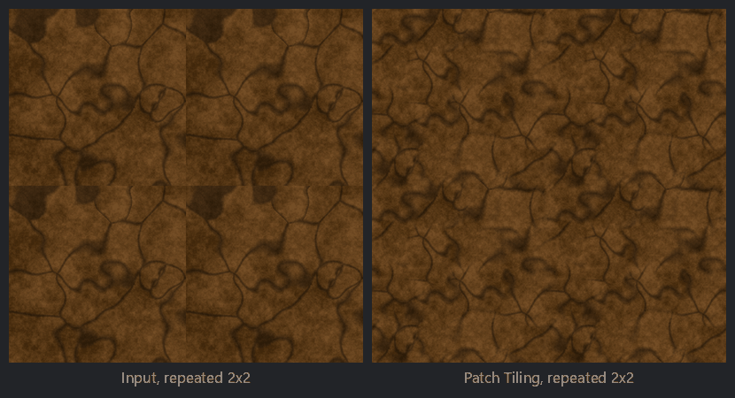

Patch Tiling node
~~~~~~~~~~~~~~~~~

The **Patch Tiling** node makes an image tileable by recombining random patches of it. The output
is a grid of patches that repeats at the edges of the image, so it always tiles. Each patch shows
a random area of the image (away from its edges), and patches are blended with soft edges. The
blending keeps the contrast of the image (histogram preserving blending), so the transitions do
not look blurry.

It works best on stochastic textures such as gravel, grass, sand or noise. Images with large
features or a regular structure (bricks, tiles) are better made tileable by other means.

Inputs
++++++

* **Input**: the image (it does not need to tile)

Outputs
+++++++

* **Output**: the tileable image

Parameters
++++++++++

* **Patches**: the number of patches in each direction
* **Softness**: the softness of the transitions between patches
* **Jitter**: how much the patches' centers are moved randomly
* **Rotation**: the random rotation of the patches (1 is any angle). Keep it at 0 for
  directional images (wood, light coming from one side).
* **Keep contrast**: keeps the contrast of the image where patches are blended (histogram
  preserving blending), instead of averaging them

The node's seed selects the patches.

Example images
++++++++++++++

A photo that does not tile, repeated 2x2, and the result of the **Patch Tiling** node, repeated 2x2:

