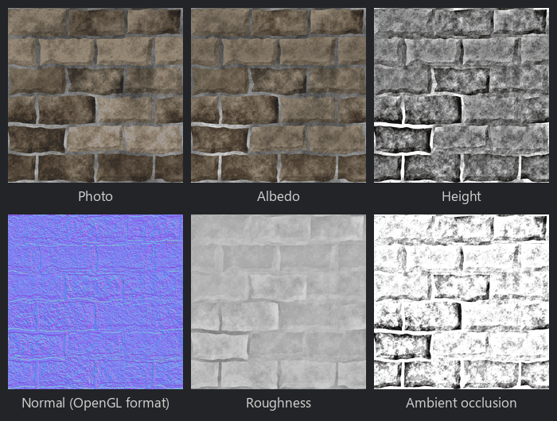

Photo to Material node
~~~~~~~~~~~~~~~~~~~~~~

The **Photo to Material** node generates material maps from a single photo of a surface: a delit
albedo, and height, normal, roughness and ambient occlusion maps estimated from the photo's details.

The maps are estimates, based on the usual assumptions for photos of rough surfaces lit from the
front: bright details are high, dark details are cavities, and shiny areas are bright. It is a
quick way to get a usable material from a photo; for more control, combine the **Delight**,
**Normal Map** and other filter nodes.

* The albedo is the photo divided by its luminance blurred over twice the *Detail radius* (as the
  **Delight** node does it)
* The height is the photo's luminance minus its blur over the *Detail radius*, relative to the
  local lighting (so it does not depend on how bright the area is)
* The normal map is computed from the height map as the **Normal Map** node does it
* The roughness is estimated from the albedo's brightness
* The ambient occlusion is estimated from the cavities of the height map

Inputs
++++++

* **Photo**: the photo of a surface, ideally lit evenly from the front

Outputs
+++++++

* **Albedo**: the photo without large scale lighting variations
* **Height**: the height estimated from the photo's details (bright is high)
* **Normal**: a normal map computed from the height
* **Roughness**: the roughness estimated from the brightness (bright, shiny areas are smoother)
* **Ambient occlusion**: the ambient occlusion estimated from the cavities of the height

Parameters
++++++++++

* **Size**: the resolution of the height and normal maps
* **Detail radius**: the size of the details that make the height; larger variations are
  considered lighting
* **Tileable**: set it for tileable photos, so blurs wrap around the edges of the image. When it is
  not set, the image is mirrored at its edges.
* **Delight**: how much large scale lighting is removed from the albedo
* **Height contrast**: the contrast of the height map
* **Invert height**: makes dark areas high instead of low
* **Normal strength**: the strength of the normal map
* **Roughness min**: the roughness of the brightest areas
* **Roughness max**: the roughness of the darkest areas
* **AO strength**: the strength of the ambient occlusion

Example images
++++++++++++++

A photo of a stone wall, and the generated albedo, height, normal, roughness and ambient occlusion maps:

