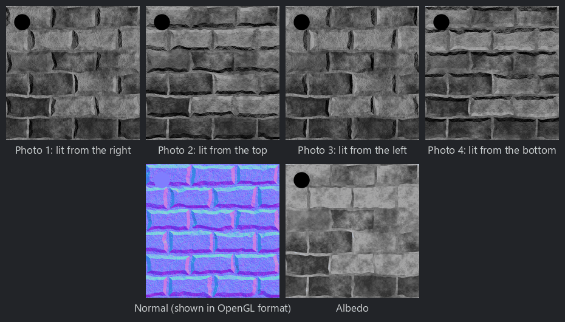

Photometric Stereo node
~~~~~~~~~~~~~~~~~~~~~~~

The **Photometric Stereo** node reconstructs a normal map and an albedo map from 3 or 4 photos
of a surface taken from the same point of view, each lit by a single light from a known
direction (for example a flash or a lamp moved around the surface).

It assumes a diffuse (Lambertian) surface: the brightness of each pixel is its albedo multiplied by
the cosine of the angle between the surface's normal and the direction of the light. The node
solves these equations for each pixel (with a least squares fit when there are 4 photos).
Shiny surfaces and cast shadows reduce the quality of the result. With 4 photos, the darkest
photo is ignored where it is much darker than the others, which removes most errors caused by
shadows. Pixels that are black in all photos get a flat normal and a zero albedo.

The photos must be aligned, and taken with the same exposure.

Inputs
++++++

* **Photo 1** to **Photo 4**: greyscale photos of the surface, each lit by one light (the
  fourth photo is ignored when *Lights* is 3)

Outputs
+++++++

* **Normal**: the normal map, in the same format as the **Normal Map** node's default format
* **Albedo**: the albedo (diffuse reflectance), relative to the intensity of the lights

Parameters
++++++++++

* **Lights**: the number of photos (3 or 4)
* **Azimuth 1** to **Azimuth 4**: the direction of each light in the image, in degrees
  (0 is the right of the image, 90 its top). The defaults are right, top, left and bottom.
* **Elevation 1** to **Elevation 4**: the elevation of each light above the surface, in degrees
  (90 is a light in front of the surface)
* **sRGB photos**: set it when the photos are sRGB encoded, as photos usually are. They are
  converted to linear values before solving, and the albedo is converted back to sRGB.
* **Shadow threshold**: with 4 photos, the darkest photo is ignored where it is darker than this
  fraction of the brightest one; 0 disables it
* **Strength**: multiplies the slopes of the normal map

Notes
+++++

The height of the surface can be computed from the normal map with the **Normal to Height** node.

Example images
++++++++++++++

4 synthetic photos of a stone wall lit from the right, top, left and bottom, and the reconstructed
normal and albedo maps:

