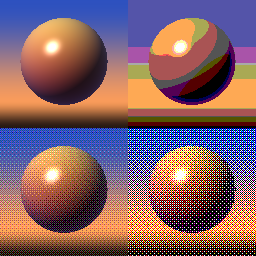

Dithered Posterize node
~~~~~~~~~~~~~~~~~~~~~~~

The **Dithered Posterize** node reduces each color channel of its input to a fixed number of
evenly spaced levels, and can hide the steps between levels with ordered (Bayer) dithering.

Inputs
++++++

The **Dithered Posterize** node accepts an RGBA input.

Outputs
+++++++

The **Dithered Posterize** node outputs an RGBA texture. Its red, green and blue channels only
contain the values 0, 1/(N-1), 2/(N-1), ... 1, where N is the number of levels. Values outside
the 0..1 range are clamped. The alpha channel is copied from the input.

Parameters
++++++++++

The **Dithered Posterize** node accepts the following parameters:

* *Levels* is the number of levels of each color channel, including black and white
  (2 to 256, rounded to a whole number)

* *Dither* is the amount of dithering. At 0, each value is rounded to the nearest level.
  At 1, each pixel is rounded up or down depending on a threshold taken from a Bayer
  matrix, so that the average of the output over a tile of the matrix is the input value
  (to within 1/(2*M*M) of a level step for an MxM matrix). Values in between blend the
  two.

* *Pattern* is the size of the Bayer matrix (2x2, 4x4, 8x8 or 16x16). Larger matrices
  produce more intermediate shades between two levels (M*M+1 for an MxM matrix).

* *Size* is the resolution of the dithering pattern. Set it to the resolution of the
  texture to dither each pixel, or lower it for a coarser, retro-looking pattern. The
  pattern always tiles. Don't set it higher than the resolution of the texture: the
  pattern is then sampled between its cells, which breaks it (the output can collapse
  to a single level).

The same threshold is used for the three color channels, so a grayscale input stays grayscale.

Unlike the **Quantize** node, which rounds values down (the input 1.0 is the only one that
reaches the top level), this node rounds to the nearest level. Unlike the **Pixelize** node,
it does not reduce the resolution of its input, and it preserves alpha.

Example images
++++++++++++++

