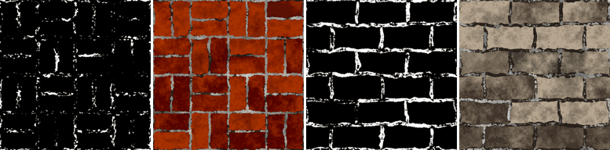

Dirt node
~~~~~~~~~

The **Dirt** node generates a mask of dirt accumulated in cavities (dark areas of an ambient occlusion
map) and concave areas (dark areas of a curvature map), broken up by noise, like Substance's *Dirt*
mask generator.

Inputs
++++++

* **Ambient occlusion**: An ambient occlusion map (white where open, dark in cavities), e.g. from the Occlusion or Mesh Map nodes
* **Curvature**: A curvature map (0.5 is flat, brighter is convex, darker is concave), e.g. from the Smooth Curvature or Mesh Map nodes

Outputs
+++++++

* **Mask**: The weathering mask (1 where the effect is present)

Parameters
++++++++++

* **Amount**: The amount of the effect: 0 gives an empty mask, 1 a full mask
* **Softness**: The softness of the mask's edges
* **Curvature weight**: How much concave areas (from the curvature map) get dirt
* **Noise scale**: The scale of the noise that breaks up the mask (rounded to a whole number so the mask tiles)
* **Noise amount**: How much the noise breaks up the mask

Notes
+++++

All weathering masks (except **Water Level**) work the same way: the node computes a value
between 0 and 1 from its inputs, adds noise, and keeps the areas above a threshold set by
*Amount*. An *Amount* of 0 always gives an empty mask (apart from the **Grunge** node's
speckles), and 1 a full mask. The noise tiles, and gives the same result on all GPUs for a
given seed.

Example images
++++++++++++++

The samples show the mask and a composite on the *bricks* and *stone wall* example materials.

