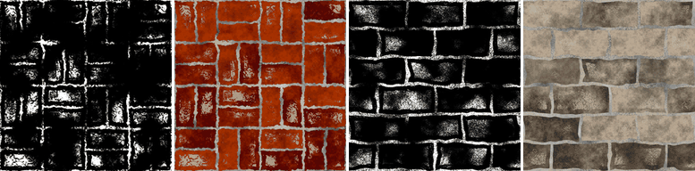

Dust node
~~~~~~~~~

The **Dust** node generates a mask of dust settled on flat surfaces and in corners, broken up by
noise. It is based on a normal map (flat surfaces facing the viewer get dust, as on a floor seen from
above) and an ambient occlusion map (for corners). For dust on the top of ledges of a wall, use the
**Moss** node, that follows a direction.

Inputs
++++++

* **Normal**: A normal map, e.g. from the Normal Map or Mesh Map nodes
* **Ambient occlusion**: An ambient occlusion map (white where open, dark in cavities), e.g. from the Occlusion or Mesh Map nodes

Outputs
+++++++

* **Mask**: The weathering mask (1 where the effect is present)

Parameters
++++++++++

* **Amount**: The amount of the effect: 0 gives an empty mask, 1 a full mask
* **Softness**: The softness of the mask's edges
* **Cavity weight**: How much corners (from the ambient occlusion map) get dust, rather than flat surfaces
* **Noise scale**: The scale of the noise that breaks up the mask (rounded to a whole number so the mask tiles)
* **Noise amount**: How much the noise breaks up the mask

Notes
+++++

All weathering masks (except **Water Level**) work the same way: the node computes a value
between 0 and 1 from its inputs, adds noise, and keeps the areas above a threshold set by
*Amount*. An *Amount* of 0 always gives an empty mask (apart from the **Grunge** node's
speckles), and 1 a full mask. The noise tiles, and gives the same result on all GPUs for a
given seed.

Example images
++++++++++++++

The samples show the mask and a composite on the *bricks* and *stone wall* example materials.

