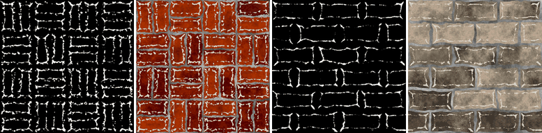

Edge Wear node
~~~~~~~~~~~~~~

The **Edge Wear** node generates a mask of worn edges: paint chipped or polished off the convex
parts of a surface. It is based on a curvature map, and occluded areas can be kept out of the mask
with an ambient occlusion map, like Substance's *Metal Edge Wear* generator.

Inputs
++++++

* **Curvature**: A curvature map (0.5 is flat, brighter is convex, darker is concave), e.g. from the Smooth Curvature or Mesh Map nodes
* **Ambient occlusion**: An ambient occlusion map (white where open, dark in cavities), e.g. from the Occlusion or Mesh Map nodes

Outputs
+++++++

* **Mask**: The weathering mask (1 where the effect is present)

Parameters
++++++++++

* **Amount**: The amount of the effect: 0 gives an empty mask, 1 a full mask
* **Softness**: The softness of the mask's edges
* **Occlusion weight**: How much occluded areas (from the ambient occlusion map) are protected from wear
* **Noise scale**: The scale of the noise that breaks up the mask (rounded to a whole number so the mask tiles)
* **Noise amount**: How much the noise breaks up the mask

Notes
+++++

All weathering masks (except **Water Level**) work the same way: the node computes a value
between 0 and 1 from its inputs, adds noise, and keeps the areas above a threshold set by
*Amount*. An *Amount* of 0 always gives an empty mask (apart from the **Grunge** node's
speckles), and 1 a full mask. The noise tiles, and gives the same result on all GPUs for a
given seed.

Example images
++++++++++++++

The samples show the mask and a composite on the *bricks* and *stone wall* example materials, with curvature computed by **Smooth Curvature 2** (radius 0.5) from their height maps.

