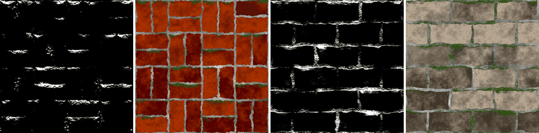

Moss node
~~~~~~~~~

The **Moss** node generates a mask of moss (or snow, or any deposit) growing on the parts of a
surface that face a direction (up by default) and in cavities, broken up by noise. It is based on a
normal map and an ambient occlusion map.

Inputs
++++++

* **Normal**: A normal map, e.g. from the Normal Map or Mesh Map nodes
* **Ambient occlusion**: An ambient occlusion map (white where open, dark in cavities), e.g. from the Occlusion or Mesh Map nodes

Outputs
+++++++

* **Mask**: The weathering mask (1 where the effect is present)

Parameters
++++++++++

* **Amount**: The amount of the effect: 0 gives an empty mask, 1 a full mask
* **Softness**: The softness of the mask's edges
* **Direction**: The direction moss grows towards, in degrees (0 is right, 90 is up in the image)
* **Cavity weight**: How much cavities (from the ambient occlusion map) get moss, rather than surfaces facing the direction
* **Noise scale**: The scale of the noise that breaks up the mask (rounded to a whole number so the mask tiles)
* **Noise amount**: How much the noise breaks up the mask

Notes
+++++

All weathering masks (except **Water Level**) work the same way: the node computes a value
between 0 and 1 from its inputs, adds noise, and keeps the areas above a threshold set by
*Amount*. An *Amount* of 0 always gives an empty mask (apart from the **Grunge** node's
speckles), and 1 a full mask. The noise tiles, and gives the same result on all GPUs for a
given seed.

Example images
++++++++++++++

The samples show the mask and a composite on the *bricks* and *stone wall* example materials.

