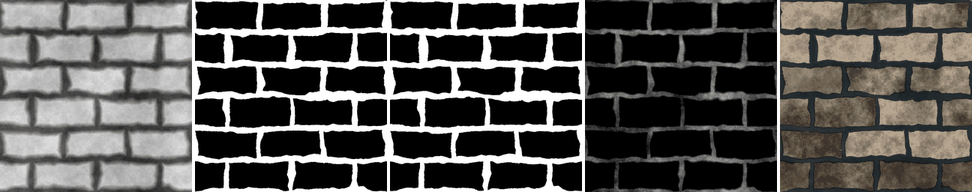

Water Level node
~~~~~~~~~~~~~~~~

The **Water Level** node fills the low areas of a height map with water. It generates a mask of the
water, a mask of the wet band above it, and the depth of the water, with optional ripples that
perturb the water's edge.

Inputs
++++++

* **Height**: The height map

Outputs
+++++++

* **Water**: 1 where the height is below the water level
* **Wet**: 1 in the water, fading out in a band above it
* **Depth**: The depth of the water, relative to the level (1 where the height is 0)

Parameters
++++++++++

* **Level**: The height of the water surface
* **Shore**: The height of the wet band above the water
* **Softness**: The softness of the water's edge
* **Ripples**: How much noise perturbs the water's edge
* **Noise scale**: The scale of the noise (rounded to a whole number so the masks tile)

Example images
++++++++++++++

The samples show the height map of the *stone wall* example, the water, wet and depth outputs, and a composite.

