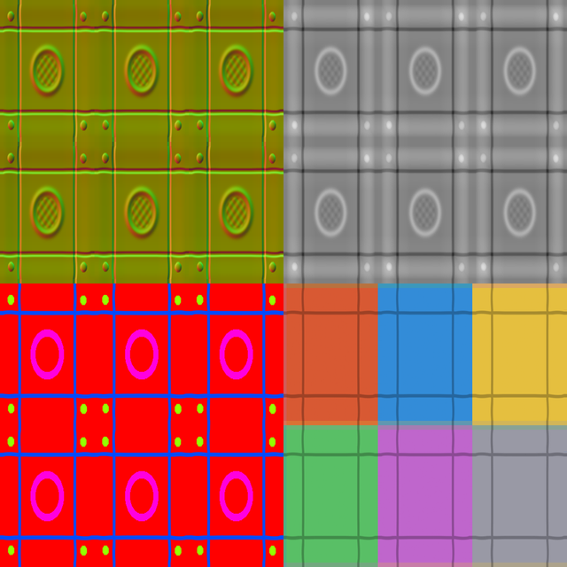

High Poly Bake node
~~~~~~~~~~~~~~~~~~~

The **High Poly Bake** node bakes maps of a high poly mesh onto the UV layout of the
current custom mesh (the low poly mesh selected in the 3D preview), and recalculates
automatically when either mesh changes.

For each texel of the current mesh, a ray is cast from a cage (the current mesh pushed
along its normals, or a custom cage mesh) towards the current mesh, and the closest
high poly surface it hits provides the baked values.

Inputs
++++++

The **High Poly Bake** node does not accept any input.

Outputs
+++++++

The **High Poly Bake** node outputs the selected map, which can be the following:

* **Normal (tangent space)**: a normal map that can be connected directly to the normal
  input of the Material node. The tangent space is generated with MikkTSpace when the
  mesh has no tangents, as in most engines
* **Normal (object space)**: the normal of the high poly surface
* **Height**: the distance between the high poly surface and the current mesh (0.5 is the
  current mesh, 1.0 and 0.0 are the front and rear distances)
* **Vertex color**: the vertex colors of the high poly mesh (glTF and FBX files, and OBJ files
  with vertex colors written as "v x y z r g b")
* **Material ID**: a different color for each material of the high poly mesh (glTF and FBX
  surfaces, OBJ usemtl)
* **Position**: the position of the high poly surface, in the bounding box of the current mesh
* **Coverage**: 1.0 where rays hit the high poly mesh, 0.0 where they missed it
* **Transferred texture**: the high poly mesh's own texture (the **High poly texture**
  parameter), sampled at the hit point with the high poly mesh's UVs, in the UV layout of the
  current mesh (black where rays missed the high poly mesh)

Parameters
++++++++++

The **High Poly Bake** node has the following parameters:

* **High poly** is the high poly mesh file, in the same space as the current mesh
* **Cage** is an optional cage mesh, with the same topology as the current mesh (an
  inflated copy of it). When it is set, rays start from the cage and the front distance
  is not used
* **Map** is the baked map
* **Size** is the size of the baked map
* **Front distance** and **Rear distance** are the maximum distances of the high poly
  surface in front of and behind the current mesh, relative to the diagonal of its
  bounding box
* **Antialiasing** averages 1, 4 or 16 jittered samples for each texel
* **Match by name**: the parts (objects) of the current mesh are matched with the parts of
  the high poly mesh that have the same name, ignoring case, suffixes such as _low, _high, _lp
  and _hp, and Blender's duplicate numbers (.001): rays from a part only hit the matching high
  poly part, so parts that are close to each other or interpenetrate don't bake each other.
  Parts are OBJ objects and groups (o and g lines), and the meshes of glTF and FBX files (all
  their meshes are then loaded). Rays from parts without a match hit all parts. The Material ID
  map then has a color for each material of each part
* **Skew map** is an optional grayscale image in the current mesh's UV space: where it is white,
  rays go along the flat face normal of the current mesh instead of its smooth vertex normals,
  which fixes details that are skewed near hard edges (gray values bend rays in between)
* **High poly texture** is the texture of the high poly mesh, for the **Transferred texture** map
* **Hardware ray tracing** casts rays with the GPU's ray tracing hardware, which is much faster
  for big high poly meshes (no bounding volume hierarchy is built on the CPU). It needs a GPU and
  driver that support Vulkan ray tracing pipelines: otherwise a warning is shown and rays are cast
  by a compute shader, as when this option is off. Both give the same maps, up to rounding
* **UDIM tile** is the UDIM tile (1001 to 1100) of the current mesh's UV layout that is baked,
  for meshes whose UVs span several tiles: 1001 is the [0, 1] square, 1002 is on its right and
  1011 above it. Only the faces of this tile are baked, with UVs relative to the tile. Distances
  and positions are still relative to the bounding box of the whole mesh, so the maps of all
  tiles match. UDIM exports bake each tile of the mesh (see :ref:`export-section`)

Maps are extended past the borders of UV islands, so they don't show seams when they are
mipmapped or filtered. UV islands can be mirrored.

Baking is also available from the command line (see the **--high** option of **--bake**).

Example images
++++++++++++++

Tangent space normal, height, material ID and vertex color maps of a detailed high poly box
(with 4 materials and vertex colors), baked on a low poly rounded box:

