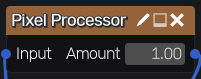

Pixel Processor node
~~~~~~~~~~~~~~~~~~~~

The **Pixel Processor** node computes each pixel of its output with a *function graph*:
a small typed graph of operations (arithmetic, vector operations, comparisons, selection,
sampling of its inputs at any position, random values, sub-functions and loops...) that is
compiled to GLSL.

Inputs
++++++

The **Pixel Processor** node has the image inputs declared in its function graph
(one RGBA input named *Input* by default). Inputs can be sampled several times at
arbitrary positions.

Outputs
+++++++

The **Pixel Processor** node has a single RGBA output. A grayscale result is output
as gray with an opaque alpha.

Parameters
++++++++++

The **Pixel Processor** node has the float parameters declared in its function graph
(an *Amount* parameter by default, that blends the input with its inverse).
If the function graph uses the *size* operation, a *Size* parameter is added.

Function graph editor
+++++++++++++++++++++

Click the node's edit button to open the function graph editor:

* *Add node* adds an operation (grouped by category). Connect a node's output to the
  inputs of other nodes, and set constants and settings directly in the nodes.

* *Set output* chooses the node whose value is the result of the graph.

* Each node shows its type (float, vec2, vec3, vec4, int or bool). Nodes with errors are
  shown in red, with the error in their tooltip (for example a missing operand, a cycle
  or operands of incompatible types), and *Apply* and *OK* are disabled until the graph
  is valid.

* The side panel defines the node's inputs and parameters.

* *Add function* creates a sub-function, with typed arguments, that can be used with the
  *call* operation, or repeated with the *loop* operation (a loop function takes an
  accumulator and the iteration index, and returns the new accumulator).

* *Edit JSON* shows the function graph as text.

* *Undo* and *Redo* (or Control+Z and Control+Y / Control+Shift+Z when no text field has
  the focus) undo and redo changes in the editor. Each *Apply* (and *OK*) is a single
  step in the material's undo history.

Function graph format
+++++++++++++++++++++

A function graph is a JSON object with these keys:

* *inputs*: the image inputs, as a list of objects with a *name* and a *label*

* *parameters*: the float parameters, as a list of objects with a *name*, a *label*,
  and optional *min*, *max*, *step* and *default* values

* *nodes*: an object that maps node names to operations. Each operation has an *op*
  key, and refers to its operands by node name (keys *a*, *b*... as listed below).
  Nodes must not form cycles.

* *output*: the name of the node whose value is the color of the pixel. A float or int
  is output as gray, a *vec2* gets a blue component of 0, and the alpha of a *vec2*
  or *vec3* is 1.

* *functions* (optional): sub-functions, as an object that maps function names to
  objects with *params* (a list of objects with a *name* and a *type*), *nodes* and
  an *output*. In a sub-function, the *arg* operation reads an argument. Functions
  can call other functions, but not themselves.

For example, this function graph multiplies its input by a parameter:

.. code-block:: json

	{
		"inputs": [ { "name": "in", "label": "Input" } ],
		"parameters": [ { "name": "k", "label": "Factor", "min": 0, "max": 4, "default": 1 } ],
		"nodes": {
			"uv": { "op": "pos" },
			"color": { "op": "sample", "input": 0, "uv": "uv" },
			"k": { "op": "param", "name": "k" },
			"out": { "op": "mul", "a": "color", "b": "k" }
		},
		"output": "out"
	}

Values have one of the types *bool*, *int*, *float*, *vec2*, *vec3* and *vec4*. Floats
are broadcast to vectors when needed, but ints and floats are never mixed (use
*to_float* and *to_int*). The operations are:

* constants: *float* and *int* (with a *value*), *vec2*, *vec3* and *vec4* (with a list
  of values in *value*), *true* and *false*

* variables: *pos* (the UV coordinates of the pixel, a *vec2*), *size* (the image size
  in pixels, a *vec2*), *param* (the float parameter *name*), *arg* (the argument
  *name* of a sub-function)

* sampling: *sample* returns the color (a *vec4*) of input number *input* at position *uv*

* arithmetic: *add*, *sub*, *mul*, *div*, *min*, *max* and *mod* (also on ints), *pow*,
  *atan2* and *step* (operands *a* and *b*)

* functions of one operand *a*: *neg*, *abs* and *sign* (also on ints), *floor*, *ceil*,
  *fract*, *sqrt*, *sin*, *cos*, *tan*, *exp*, *log* and *normalize*

* vectors: *dot*, *distance* and *cross* (operands *a* and *b*), *length* (operand *a*),
  *vec2*, *vec3* and *vec4* built from the nodes listed in *args* (their components
  must add up to the vector's size, or be a single float), and *swizzle* (the
  *components* of *a*, such as ``"xy"`` or ``"bgr"``)

* interpolation: *mix* (*a*, *b* and *t*), *clamp* (*a*, *min* and *max*) and
  *smoothstep* (*e0*, *e1* and *a*)

* comparisons: *lt*, *le*, *gt*, *ge*, *eq* and *ne* compare two floats or two ints
  (*a* and *b*) and return a bool

* logic: *and*, *or* and *not* on bools, and *select*, that returns *a* if *cond* is
  true and *b* otherwise

* conversions: *to_int* (rounds down) and *to_float*

* sub-functions: *call* calls *function* with the nodes listed in *args*, and *loop*
  repeats *function* *count* times (at most 1024): the function takes an accumulator
  and the iteration index (an int) and returns the new accumulator, that starts
  with the value of *init*

* random numbers: *rand* returns a random float between 0 and 1 for a *vec2* seed *a*
  (for example the position) and the node's seed. It uses an integer hash, so it gives
  the same values on all GPUs.

Integer *mod* has the sign of its divisor, like *mod* on floats, so it can be used to
wrap negative coordinates.
