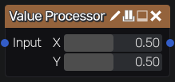

Value Processor node
~~~~~~~~~~~~~~~~~~~~

The **Value Processor** node computes a single value with a function graph, once, instead
of computing it for each pixel. Its output is constant over the whole image, and can be
used by other nodes as a uniform color or value (for example the average, minimum or
maximum of an image, measured by sampling it).

It is edited like the **Pixel Processor** node, in the function graph editor (see its
documentation for the editor, the function graph format and the list of operations), but its
function graph cannot use the pixel position (*pos* and *size*, that the editor does not
offer). It can sample its inputs at positions computed from its parameters,
or at many positions in a loop.

The result is rendered into a 1x1 buffer, so nodes that use it only read a single texel
instead of evaluating the function graph for each of their pixels.

Inputs
++++++

The **Value Processor** node has the image inputs declared in its function graph (one RGBA
input by default).

Outputs
+++++++

The **Value Processor** node has a single RGBA output, that is constant over the image.

Parameters
++++++++++

The **Value Processor** node has the float parameters declared in its function graph. By
default, *X* and *Y* define the position where the input is sampled.

Example
+++++++

This function graph computes the minimum and maximum of the red channel of its input,
sampled on a 32x32 grid, as the red and green components of its output. A **Pixel
Processor** can then use them to stretch the input's levels to the full range:

.. code-block:: json

	{
		"inputs": [ { "name": "in", "label": "Input" } ],
		"parameters": [],
		"functions": {
			"minmax": {
				"params": [ { "name": "acc", "type": "vec2" }, { "name": "i", "type": "int" } ],
				"nodes": {
					"acc": { "op": "arg", "name": "acc" },
					"i": { "op": "arg", "name": "i" },
					"n": { "op": "int", "value": 32 },
					"ix": { "op": "mod", "a": "i", "b": "n" },
					"iy": { "op": "div", "a": "i", "b": "n" },
					"fx": { "op": "to_float", "a": "ix" },
					"fy": { "op": "to_float", "a": "iy" },
					"half": { "op": "float", "value": 0.5 },
					"px": { "op": "add", "a": "fx", "b": "half" },
					"py": { "op": "add", "a": "fy", "b": "half" },
					"p": { "op": "vec2", "args": [ "px", "py" ] },
					"s": { "op": "float", "value": 0.03125 },
					"uv": { "op": "mul", "a": "p", "b": "s" },
					"c": { "op": "sample", "input": 0, "uv": "uv" },
					"v": { "op": "swizzle", "a": "c", "components": "x" },
					"lo": { "op": "swizzle", "a": "acc", "components": "x" },
					"hi": { "op": "swizzle", "a": "acc", "components": "y" },
					"new_lo": { "op": "min", "a": "lo", "b": "v" },
					"new_hi": { "op": "max", "a": "hi", "b": "v" },
					"out": { "op": "vec2", "args": [ "new_lo", "new_hi" ] }
				},
				"output": "out"
			}
		},
		"nodes": {
			"init": { "op": "vec2", "value": [ 1, 0 ] },
			"out": { "op": "loop", "function": "minmax", "count": 1024, "init": "init" }
		},
		"output": "out"
	}

Parameter functions
+++++++++++++++++++

Any float parameter that accepts expressions can also be defined with a function graph:
right click the parameter to open the expression editor, and click *Function graph...*.
Those function graphs can use constants, *time* and the graph's named parameters (with
the *param* operation), but not the pixel position, inputs, random numbers or
sub-functions, and their output must be a float. They are compiled to an expression that
becomes the parameter's value. The function graph is saved with the node, so it can be
edited again later (if the parameter was modified in another way, editing starts from its
current value).
