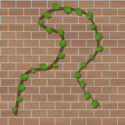

Spline Mapper node
~~~~~~~~~~~~~~~~~~

The **Spline Mapper** node places instances of a pattern along a curve, at regular distances
and oriented along the curve, with random scale, rotation, offset and height. Where instances
overlap, the highest one is visible. Unlike the **Poly Curve** node, it does not stretch the
pattern along the curve.

Inputs
++++++

The **Spline Mapper** node has a single RGBA input, the pattern placed along the curve. The x
axis of the pattern follows the curve.

Outputs
+++++++

* *Output* is the pattern instances along the curve

* *Mask* is the opacity of the visible instance

Parameters
++++++++++

* the *curve*, edited in the 2D preview. It goes smoothly through its control points and has
  the same shape as the **Poly Curve** node's curve with the same points

* *Count* is the number of instances along the curve

* *Size* is the size of instances

* *Scale random*, *Rotation*, *Rotation random*, *Offset random* and *Height random* add
  variations to the instances

Notes
+++++

The height of an instance is the brightness of the pattern, multiplied by its alpha and
by a random factor (*Height random*). Dark parts of the pattern are hidden by the instances
they overlap.

Like the **Poly Curve** node, the curve does not wrap around the edges of the texture.

Example images
++++++++++++++

