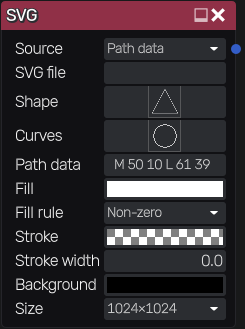
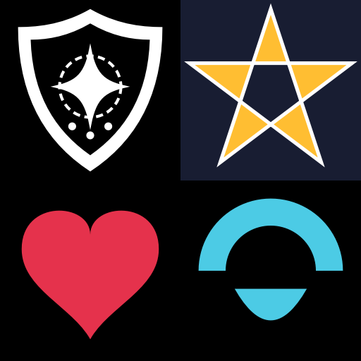

SVG node
~~~~~~~~

The **SVG** node renders vector graphics: an SVG file, path data edited in the node, or a
shape or curves edited in the 2D preview.
Vector graphics are rendered at the selected resolution, so they stay sharp.

Inputs
++++++

The **SVG** node does not accept any input.

Outputs
+++++++

* **Output**: the rendered image (RGBA)

Parameters
++++++++++

* **Source**: what is rendered: the path data, the shape, the SVG file, or the curves
* **SVG file**: an SVG file, used with the *File* source, or when the path data is empty.
  The graph only stores the path of the file
* **Shape**: a polygon, edited in the 2D preview (drag its points, double click to add a
  point), used with the *Shape* source
* **Curves**: cubic Bézier curves, edited in the 2D preview like the curves of the Splines
  node, used with the *Curves* source. Curves whose ends meet are joined into one outline, and
  outlines that end where they start are closed and filled. The default is a circle
* **Path data**: SVG path data (the *d* attribute of an SVG path) on a 100x100 canvas, for
  example *M 10 10 L 90 10 L 50 90 Z*. All path commands can be used (*M*, *L*, *H*, *V*,
  *C*, *S*, *Q*, *T*, *A*, *Z* and their relative lowercase versions). The path is rendered
  up to its first invalid character. The default is a star
* **Fill** and **Stroke**: the colors of the path, shape or curves
* **Fill rule**: how overlapping outlines are filled: *Non-zero* fills everything inside the
  outline, *Even-odd* leaves holes where outlines overlap
* **Stroke width**: the width of the outline, on the 100x100 canvas
* **Background**: the color the graphics are drawn on. It is opaque black by default, so the
  output can be used as an anti-aliased mask. With a transparent background, the output is
  transparent outside of the shapes, and its alpha channel is the anti-aliased mask
* **Size**: the resolution of the rendered image

When the *Shape* or *Curves* source is selected, the 2D preview shows its editor.

SVG files can use paths, basic shapes, groups, transforms, strokes (with dashes, joins
and caps), fill rules and the *viewBox* attribute. Non square documents are centered.
Documents that are not well formed are not rendered.

Example images
++++++++++++++

