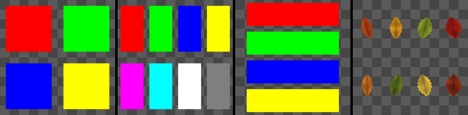

Atlas Creator node
~~~~~~~~~~~~~~~~~~

The **Atlas Creator** node creates an atlas from up to 8 images, on a grid.

Inputs
++++++

* **Image 1**: Image 1 of the atlas (index 0)
* **Image 2**: Image 2 of the atlas (index 1)
* **Image 3**: Image 3 of the atlas (index 2)
* **Image 4**: Image 4 of the atlas (index 3)
* **Image 5**: Image 5 of the atlas (index 4)
* **Image 6**: Image 6 of the atlas (index 5)
* **Image 7**: Image 7 of the atlas (index 6)
* **Image 8**: Image 8 of the atlas (index 7)

Outputs
+++++++

* **Output**: The atlas

Parameters
++++++++++

* **Layout**: The layout of the atlas: columns x rows (images that don't fit are not used)
* **Padding**: The empty margin around each image, relative to its cell

Notes
+++++

Images are placed from the top left corner, row by row: the 2x2 layout gives the same
atlas as the **Tile 2x2** node, and the 2x2 and 4x4 atlases used by the **Tiler**, **Splatter**
and **Custom UV** nodes can be made with it. The atlas can be split again with the
**Atlas Splitter** node (same columns, rows and index), or scattered with the **Atlas Scatter**
node. *Padding* leaves an empty (transparent) margin around each image, which keeps the images
apart for the **Fill** node used by the **Atlas Islands** and **Atlas Island Scatter** nodes.

Example images
++++++++++++++

The samples show 8 colors in the 2x2, 4x2 and 1x4 layouts with a 0.1 padding, and the leaves atlas rebuilt from 8 Atlas Splitter nodes.

