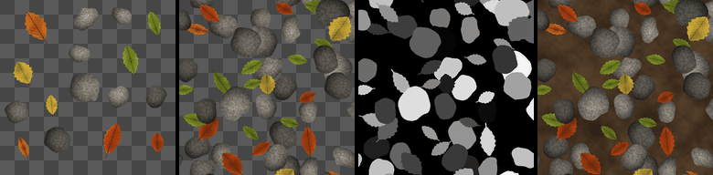

Atlas Island Scatter node
~~~~~~~~~~~~~~~~~~~~~~~~~

The **Atlas Island Scatter** node scatters random items of an atlas whose items are not on a grid (found by a **Fill** node), at most one per cell of a grid, with random offset, scale, rotation and value.

Inputs
++++++

* **Atlas**: The atlas: separate items on a transparent or uniform background
* **Fill**: The output of a Fill node that finds the atlas items: its input must be white between the items (for example the atlas's inverted alpha)

Outputs
+++++++

* **Output**: The scattered instances
* **Mask**: The coverage of the instances (the output's alpha)
* **Instance**: A random value for each instance (of the one on top), 0 where there is none

Parameters
++++++++++

* **Count**: The number of cells of the grid on each side (at most one instance per cell)
* **Scale**: The size of instances (their longest side), relative to their cell
* **Scale random**: The random reduction of the size of each instance
* **Rotation random**: The random rotation of each instance (up to this angle either way, in degrees)
* **Offset random**: The random offset of each instance from its cell's center, relative to the cell
* **Value random**: The random darkening of each instance
* **Drop**: The proportion of cells left empty
* **Rotate to fit**: Rotates items by a quarter turn so they fit their square better
* **Blend**: How overlapping instances are combined:

  * Normal: alpha blending, in a random order
  * Max: the maximum of the instances (premultiplied by their alpha), for height maps

Notes
+++++

As for the **Atlas Islands** node, the *Fill* input is the output of a **Fill** node whose
input is white between the atlas's items. Each instance is the item under a random point of
the atlas, so large items are picked more often than small ones. Items are scaled so their
longest side is *Scale* times the cell's size, and can be rotated by a quarter turn
(*Rotate to fit*) so that their longest side is horizontal before the random rotation.

The scatter itself works as in the **Atlas Scatter** node: at most one instance per cell, no
cuts at cell borders, blending in a random order or with a maximum, and an output that tiles
and is the same on every GPU.

This node is the equivalent of Substance 3D Designer's *Atlas Scatter* node, which also
scatters the shapes of an atlas found with a flood fill.

Example images
++++++++++++++

The samples show an atlas of leaves and pebbles, its scatter, the *Instance* output, and the scatter over a ground texture.

