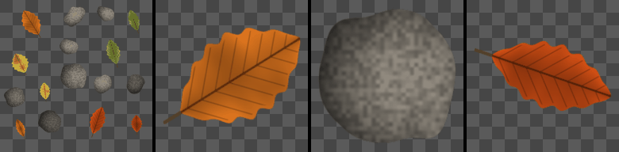

Atlas Islands node
~~~~~~~~~~~~~~~~~~

The **Atlas Islands** node extracts one item of an atlas whose items are not on a grid (separate items on a background, found by a **Fill** node), scaled to fit the output.

Inputs
++++++

* **Atlas**: The atlas: separate items on a transparent or uniform background
* **Fill**: The output of a Fill node that finds the atlas items: its input must be white between the items (for example the atlas's inverted alpha)

Outputs
+++++++

* **Output**: The extracted item, on a transparent background

Parameters
++++++++++

* **Pick X**: The X coordinate of a point of the item to extract
* **Pick Y**: The Y coordinate of a point of the item to extract
* **Margin**: The margin around the item
* **Rotate to fit**: Rotates items by a quarter turn so they fit their square better

Notes
+++++

Connect a mask that is white between the atlas's items (for example the atlas's alpha
through an **Invert** node, or a mask of its background) to a **Fill** node, and the **Fill**
node to the *Fill* input. *Pick X* and *Pick Y* select the item to extract: any point inside it.
Only the pixels of the item are kept, so items whose bounding boxes overlap are separated.

The **Fill** node's resolution should match the atlas's, and its *Remove edges* option keeps
the antialiased edges of the items.

This node is the equivalent of Substance 3D Designer's *Atlas Splitter* node, which also
detects the shapes of an atlas with a flood fill.

Example images
++++++++++++++

The samples show an atlas of leaves and pebbles, and three items extracted from it.

