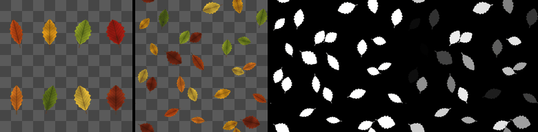

Atlas Scatter node
~~~~~~~~~~~~~~~~~~

The **Atlas Scatter** node scatters random images of an atlas whose images are on a grid, at most one per cell of a grid, with random offset, scale, rotation and value.

Inputs
++++++

* **Atlas**: The atlas: a grid of images, indexed from the top left corner, row by row

Outputs
+++++++

* **Output**: The scattered instances
* **Mask**: The coverage of the instances (the output's alpha)
* **Instance**: A random value for each instance (of the one on top), 0 where there is none

Parameters
++++++++++

* **Columns**: The number of columns of the atlas
* **Rows**: The number of rows of the atlas
* **Count**: The number of cells of the grid on each side (at most one instance per cell)
* **Scale**: The size of instances (their longest side), relative to their cell
* **Scale random**: The random reduction of the size of each instance
* **Rotation random**: The random rotation of each instance (up to this angle either way, in degrees)
* **Offset random**: The random offset of each instance from its cell's center, relative to the cell
* **Value random**: The random darkening of each instance
* **Drop**: The proportion of cells left empty
* **Blend**: How overlapping instances are combined:

  * Normal: alpha blending, in a random order
  * Max: the maximum of the instances (premultiplied by their alpha), for height maps

Notes
+++++

Each cell of a *Count* x *Count* grid gets at most one instance (none in the proportion of
cells set by *Drop*): a random image of the atlas, with a random offset, size, rotation and
darkening. Instances keep the aspect ratio of the atlas's cells, can overflow their cell (up to
twice its size, rotated and offset), and are never cut at cell borders. Overlapping instances
are blended in a random order (*Normal*), or combined with a maximum (*Max*, for height maps).

The result tiles, and depends only on the node's seed: random values come from an integer hash,
so they are the same on every GPU.

Compared with the **Tiler** and **Splatter** nodes, which also pick random images of 4 or 16
image atlases, Atlas Scatter accepts any grid (up to 16x16), keeps non square cells' proportions,
blends overlapping images with their alpha, and outputs a random value per instance.

Example images
++++++++++++++

The samples show an atlas of 4x2 leaves, its scatter, and the *Mask* and *Instance* outputs.

