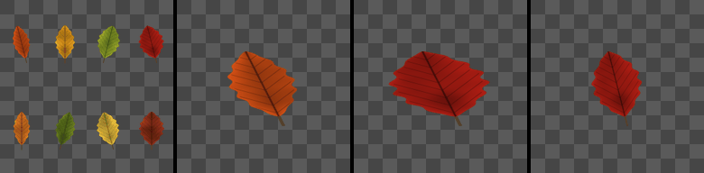

Atlas Splitter node
~~~~~~~~~~~~~~~~~~~

The **Atlas Splitter** node extracts one image of an atlas whose images are on a grid, by index.

Inputs
++++++

* **Atlas**: The atlas: a grid of images, indexed from the top left corner, row by row

Outputs
+++++++

* **Output**: The extracted image

Parameters
++++++++++

* **Columns**: The number of columns of the atlas
* **Rows**: The number of rows of the atlas
* **Index**: The index of the extracted image (from the top left corner, row by row; wraps around)
* **Fit**: How the image fills the output when the atlas's cells are not square:

  * Stretch: the image is stretched to fill the output
  * Keep aspect ratio: the image keeps its proportions, on a transparent background

Notes
+++++

Images are indexed from the top left corner, row by row, as in the **Tile 2x2** and
**Atlas Creator** nodes, and the index wraps around (with 4 columns and 2 rows, index 9 is
index 1). The extracted image tiles.

Example images
++++++++++++++

The samples show an atlas of 4x2 leaves, then images 0 and 3 stretched to the output, and image 3 with *Fit* set to *Keep aspect ratio*.

