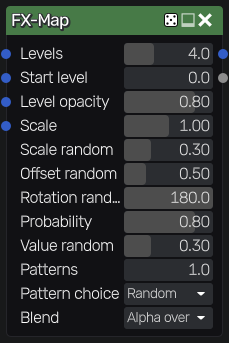
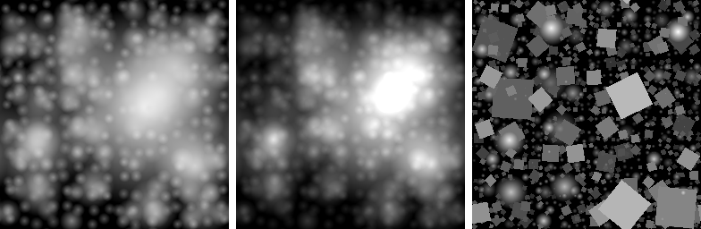

FX-Map node
~~~~~~~~~~~

The **FX-Map** node splats patterns recursively in quadrants, like a Substance Designer
FX-Map made of Quadrant nodes: level 0 has one cell covering the whole texture, and each
following level splits every cell in 4. Each cell can hold one instance of a pattern, with
a random position, size, rotation and value, and finer levels are drawn over coarser ones.

Inputs
++++++

The **FX-Map** node has 4 RGBA pattern inputs. The alpha channel of a pattern is the
coverage of its instances. By default, the patterns are a soft disc.

Grayscale patterns are fully opaque, so they work best with the *Add* and *Max* blend modes.

Outputs
+++++++

The **FX-Map** node outputs:

* the splatted patterns, drawn over black (the alpha channel is their coverage)
* a random value for the instance shown on each pixel: the topmost instance with
  *Alpha over*, and the brightest one with *Add* and *Max*

Parameters
++++++++++

The **FX-Map** node has the following parameters:

* **Levels** is the number of quadrant levels (level n has 2^n x 2^n cells, up to 10 levels)
* **Start level** is the first level that has instances
* **Level opacity** multiplies the opacity of each level relative to the previous one
* **Scale** is the size of instances relative to their cell (up to 2), and **Scale random**
  their random size reduction
* **Offset random** is the random offset of instances, relative to their cell (up to 2)
* **Rotation random** is the random rotation of instances, in degrees
* **Probability** is the probability that a cell has an instance
* **Value random** darkens instances randomly
* **Patterns** is the number of pattern inputs that are used, and **Pattern choice** decides
  whether each instance uses a random pattern or the pattern of its level
* **Blend** combines instances with alpha blending, addition or maximum

Instances that are larger than their cell or moved out of it are never cut. The result
tiles, and the node's seed changes all random values.

Example images
++++++++++++++

Alpha over, Add, and Max with 2 patterns (a disc and a square):

