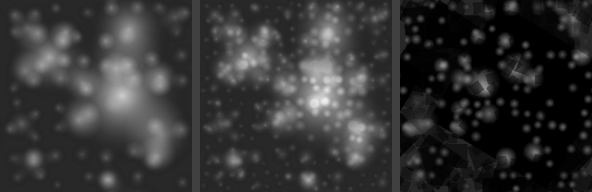

FX-Map node
~~~~~~~~~~~

The **FX-Map** node splats patterns recursively in quadrants, like Substance Designer's
FX-Map quadrant nodes: level 0 has one cell covering the whole texture, and each following
level splits every cell in 4. Each cell can hold one instance of a pattern, with a random
position, size, rotation and value, and finer levels are drawn over coarser ones.

Inputs
++++++

The **FX-Map** node has 4 pattern inputs (RGBA, the alpha channel being the coverage of
the instances). By default they are a soft disc.

Outputs
+++++++

The **FX-Map** node outputs:

* the splatted patterns (RGBA)
* a random value for the topmost instance of each pixel

Parameters
++++++++++

The **FX-Map** node has the following parameters:

* **Levels** is the number of quadrant levels (level n has 2^n x 2^n cells)
* **Start level** is the first level that has instances
* **Level opacity** multiplies the opacity of each level relative to the previous one
* **Scale** is the size of instances, relative to their cell, and **Scale random** their
  random size reduction
* **Offset random** is the random offset of instances, relative to their cell
* **Rotation random** is the random rotation of instances, in degrees
* **Probability** is the probability that a cell has an instance
* **Value random** darkens instances randomly
* **Patterns** is the number of pattern inputs that are used, and **Pattern choice** decides
  whether each instance uses a random pattern or the pattern of its level
* **Blend** combines instances with alpha blending, addition or maximum

The result tiles, and the node's seed changes all random values.

Example images
++++++++++++++

Alpha over, add, and 2 patterns (a disc and a square):

