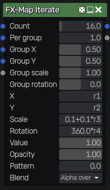
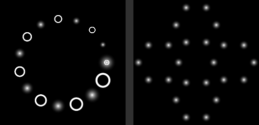

FX-Map Iterate node
~~~~~~~~~~~~~~~~~~~

The **FX-Map Iterate** node splats instances of patterns whose position, size, rotation,
value, opacity and pattern are expressions of the instance index and random values, like
Substance Designer's FX-Map Iterate and Switch nodes. Instances can be placed in groups
(nested iterations), that have their own position, scale and rotation. Parameters can be
edited with the expression and function graph editors.

Inputs
++++++

* **Pattern 1** to **Pattern 4**: the patterns of instances (their alpha channel is the
  coverage of instances). By default, the patterns are a soft disc.
* **Map**: a map that expressions can sample with ``$map(uv)``, for example
  ``$map(vec2(r1, r2))``.

Outputs
+++++++

* **Output**: the splatted patterns, drawn over black (the alpha channel is their coverage)
* **Instance**: the position of the topmost instance in the sequence of all instances (0 to 1)

Parameters
++++++++++

* **Count**: the number of instances, or of groups of instances (up to 256)
* **Per group**: the number of instances in each group (nested iteration, up to 64). With 1,
  each group is a single instance
* **Group X**, **Group Y**: the position of each group's center
* **Group scale**: the size of each group: its instances are placed in a square of this
  size around its center
* **Group rotation**: the rotation of each group, in degrees
* **X**, **Y**: the position of each instance
* **Scale**: the size of each instance
* **Rotation**: the rotation of each instance, in degrees
* **Value**: multiplies the color of each instance
* **Opacity**: the opacity of each instance
* **Pattern**: the pattern input (0 to 3) of each instance, as a Switch node
* **Blend**: how instances are combined (*Alpha over*, *Add* or *Max*; later instances are
  drawn over earlier ones)

Expressions
+++++++++++

All parameters except **Count**, **Per group** and **Blend** are evaluated for each
instance, and can be expressions of:

* **i**: the index of the group (from 0), **n**: the number of groups, **t**: i/(n-1)
* **j**: the index of the instance in its group (from 0), **m**: the number of instances in a
  group, **u**: j/(m-1)
* **r1**, **r2**, **r3** and **r4**: random values for the instance
* **g1** and **g2**: random values for the group
* **$seed**, and the node's inputs (such as ``$map(uv)``)

The group parameters (**Group X**, **Group Y**, **Group scale** and **Group rotation**) can
only use i, n, t, g1, g2 and $seed. Random values are between 0 and 1, the same on every
GPU, and change with the node's seed. The result tiles: instances that cross a border of
the texture appear on the opposite side.

Example
+++++++

16 instances on a circle, scaled down along it, with alternating patterns (a disc and a ring):
**X** is ``0.5+0.35*cos(6.2832*t)``, **Y** is ``0.5+0.35*sin(6.2832*t)``, **Scale** is
``0.15-0.1*t`` and **Pattern** is ``mod(i, 2.0)``.

Nested iterations
+++++++++++++++++

With **Per group** above 1, each of the **Count** instances becomes a group of instances
(an iteration inside an iteration). **Group X**, **Group Y**, **Group scale** and
**Group rotation** place each group. **X**, **Y**, **Scale** and **Rotation** then place each
instance in its group's space (a square from 0 to 1, centered on the group and scaled by
its scale), and can also use j, m and u.

For example, 4 groups on a circle, each made of 6 instances on a smaller circle: **Count** is 4,
**Group X** is ``0.5+0.3*cos(6.2832*i/n)``, **Group Y** is ``0.5+0.3*sin(6.2832*i/n)``,
**Group scale** is 0.4, **Per group** is 6, **X** is ``0.5+0.4*cos(6.2832*j/m)`` and **Y** is
``0.5+0.4*sin(6.2832*j/m)`` (i/n and j/m go around the circle without repeating the first
position, unlike t and u that end at 1).

The circle and nested circles examples:

Function graphs
+++++++++++++++

Each parameter can also be defined with a function graph: open the expression editor of
the parameter and click *Function graph...*. The graph's parameters include the variables of
the parameter (such as **i**, **t**, **j**, **u** and **r1** to **r4**), so the graph is
evaluated for each instance.
