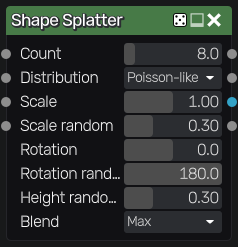
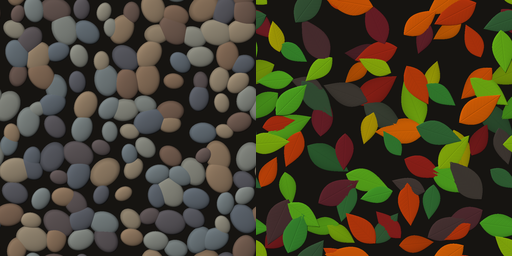

Shape Splatter node
~~~~~~~~~~~~~~~~~~~

The **Shape Splatter** node splats instances of a pattern, with a choice of distributions,
a density map, random scale, rotation and height, and height-ordered blending. It also
outputs data maps that describe the instances.

Instances are placed in a grid of *count* x *count* cells, one instance per cell, and each
pixel only evaluates the instances of the nearby cells. This keeps the node fast with
thousands of instances (the **Splatter** node evaluates all of its instances for each pixel).
Instances can be up to twice as large as a cell and are never cut at cell borders, and
the result tiles.

Inputs
++++++

* *Pattern* is the height map that is splatted. Each instance shows the pattern's unit square.

* *Density map* is the probability that an instance is kept, sampled at its position

* *Scale map* multiplies the scale of each instance (from 0 to 1), sampled at its position

* *Rotation map* adds a rotation to each instance (1 is a full turn), sampled at its position

Outputs
+++++++

* *Output* is the splatted patterns

* *Instance ID* is a random value for each instance

* *Position* is the position of each instance (red: x, green: y)

* *Mask* is white where an instance is visible

Parameters
++++++++++

* *Count* is the number of cells of the grid on each side

* *Distribution*: *Poisson-like* moves each instance a little in its cell, so instances
  stay apart (their centers are at least 0.4 cell apart), *Uniform* places them anywhere in
  their cell, *Grid* centers them in their cell

* *Scale* is the size of the largest instances, relative to the cell size (up to 2)

* *Scale random* reduces the scale of each instance by a random amount

* *Rotation* rotates all instances, in degrees

* *Rotation random* adds a random rotation to each instance, in degrees

* *Height random* reduces the height of each instance by a random amount

* *Blend*: *Max* keeps the highest instance where instances overlap (height-ordered
  blending), *Add* sums them

The random values of each instance only depend on the node's seed and on its cell, so
changing the density, scale or rotation of instances does not move the other instances.

Example images
++++++++++++++

