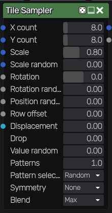
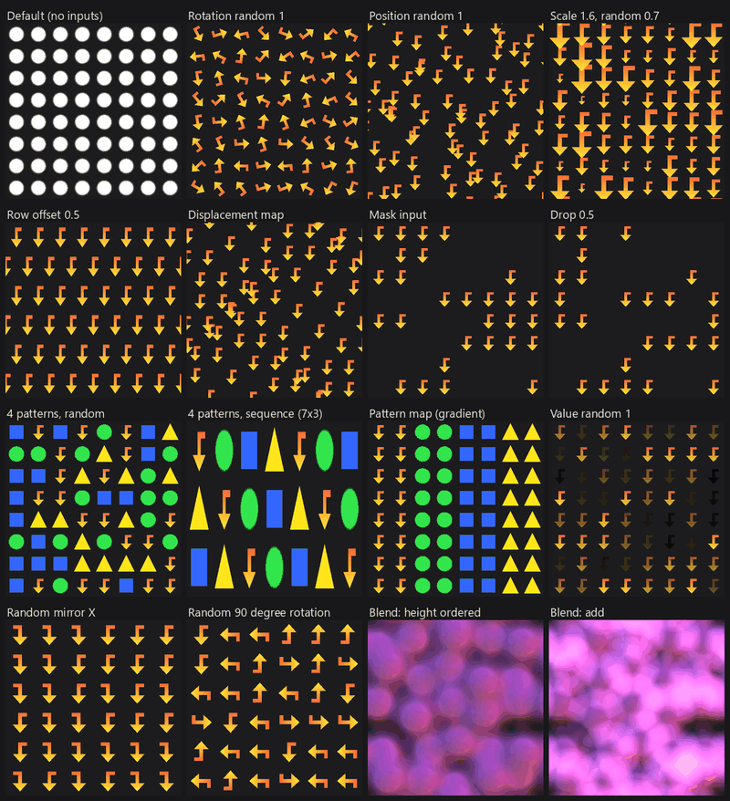

Tile Sampler node
~~~~~~~~~~~~~~~~~

The **Tile Sampler** node places instances of up to 4 patterns on a grid, one instance per
cell, with random or map driven position, scale, rotation, pattern choice, symmetry and
value, and several ways to stack overlapping instances.

Each pixel only evaluates the cells whose instance can reach it, so instances larger than
a cell (or moved out of their cell) are never cut at cell borders, and the result tiles.

Inputs
++++++

* *Pattern 1* to *Pattern 4* are the patterns that are placed (in RGBA format). Each instance
  shows the pattern's unit square, and the pattern's alpha is the coverage of the instance.
  When a pattern input is not connected, a white disk is used.

* *Mask* is the probability that an instance is kept, sampled at its position

* *Scale map* multiplies the scale of instances (from 0 to 1), sampled at their position

* *Rotation map* adds a rotation to instances (1 is a full turn), sampled at their position

* *Pattern map* selects the pattern of instances when *Pattern selection* is *By map*

* *Displacement map* is a vector map (red and green, 0.5 is no displacement) that moves
  instances, sampled at their position

Outputs
+++++++

* *Output* is the sampled patterns

* *Instance* is a random value for each instance (of the instance that is shown)

Parameters
++++++++++

* *X count* and *Y count* are the number of columns and rows of the grid

* *Scale* is the size of instances, relative to a cell (up to 2)

* *Scale random* reduces the scale of each instance by a random amount

* *Rotation* rotates all instances, in degrees

* *Rotation random* adds a random rotation to each instance (1 is up to half a turn either way)

* *Position random* moves each instance by a random offset in its cell

* *Row offset* moves odd rows, in cells (0.5 for bricks, with an even number of rows)

* *Displacement* is the amount of displacement by the displacement map (1 moves instances
  by up to half the texture). Large displacements make the node slower.

* *Drop* is the proportion of instances that are removed at random

* *Value random* darkens each instance by a random amount

* *Patterns* is the number of pattern inputs that are used

* *Pattern selection*: *Random* picks a random pattern for each instance, *By map* uses the
  pattern map, *Sequence* uses the patterns in turn, cell by cell

* *Symmetry* applies a random mirror (on X, Y or both) or a random 90 degree rotation to
  each instance

* *Blend* is how overlapping instances are combined: *Max* keeps the brightest, *Height
  ordered* stacks them in the order of a random height (the highest on top), *Alpha over*
  stacks them row by row, *Add* sums them

The random values of each instance only depend on the node's seed and on its cell, so
changing a parameter or a map does not move the other instances.

Example images
++++++++++++++

